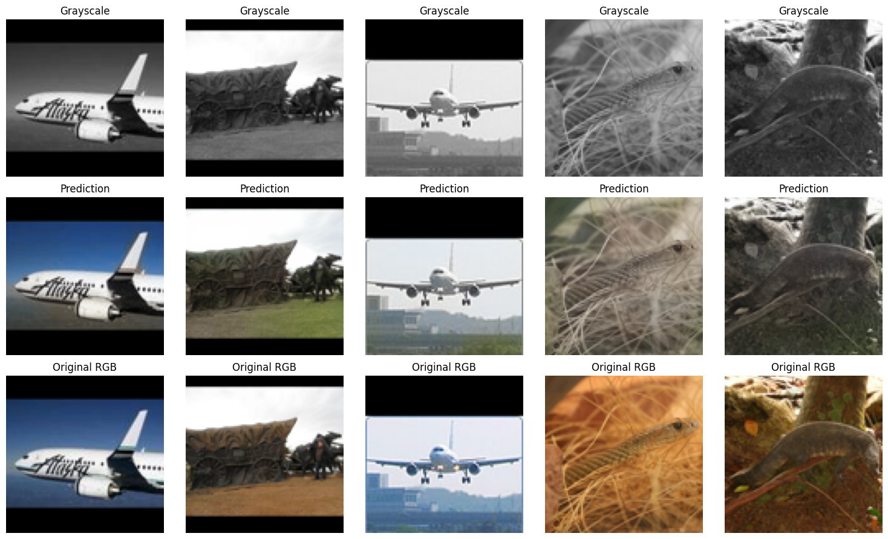

# Image Colorizer

A deep learning application that colorizes grayscale images using a pretrained U-Net model. The project provides a REST API built with **FastAPI** and a web interface built with **Streamlit**.

Try it out: https://mzivro-img-colorizer.streamlit.app/

> **NOTE**: Work is still in progress, model still somewhat struggles in certain sceneries. In the future I plan to improve the neural network's architecture and try a different dataset to train on.

## Features

- Colorizes grayscale images into RGB images using a pretrained U-Net.
- Supports image uploads in JPG, JPEG, PNG, WEBP, BMP, and TIFF formats in the web client.
- Processes large images in overlapping tiles to preserve the original image dimensions.
- Blends overlapping tile predictions with a Hann window to reduce visible tile boundaries.
- Uses CUDA when available and falls back to CPU.
- Exposes REST endpoints for health checks, readiness checks, and image colorization.
- Returns the generated image as a Base64-encoded PNG.
- Includes notebook with whole training process and demo app.

## Demo



## Technologies uses

* PyTorch
* Torchvision
* FastAPI
* Streamlit
* Pillow
* Pydantic
* Hugging Face Hub

## Architecture

```text
┌────────────────────┐
│ Streamlit client   │
│ src/client.py      │
└─────────┬──────────┘
          │ POST /colorize
          │ JSON + Base64 image
          ▼
┌────────────────────┐
│ FastAPI server     │
│ src/server.py      │
└─────────┬──────────┘
          │
          ▼
┌────────────────────┐
│ Model wrapper      │
│ src/model.py       │
│                    │
│  Grayscale image   │
│         ↓          │
│  Tiled inference   │
│         ↓          │
│  U-Net colorizer   │
│         ↓          │
│  Weighted blending │
└─────────┬──────────┘
          │ RGB image
          ▼
┌────────────────────┐
│ Base64-encoded PNG │
│ returned to client │
└────────────────────┘
```

### Model

The neural network is a U-Net-style encoder-decoder implemented in PyTorch.

- **Input:** one-channel grayscale image.
- **Output:** three-channel RGB prediction.
- **Default tile size:** 96 × 96 pixels.
- **Encoder:** three convolutional blocks with max pooling.
- **Bottleneck:** a convolutional block at the lowest spatial resolution.
- **Decoder:** transposed convolutions and skip connections.
- **Output activation:** sigmoid, constraining predicted values to `[0, 1]`.

Each `ConvBlock` contains two convolutional layers, each followed by batch normalization and ReLU activation.

For larger images, the model uses overlapping tiles. Predictions are accumulated and blended using spatial weights, then cropped to the original dimensions.

> **Note:** The model generates plausible colors from grayscale content; it cannot recover the original colors with certainty.

## Installation

### 1. Clone the repository

```bash
git clone https://github.com/mzivro/img-colorizer.git
cd img-colorizer
```

### 2. Create and activate a virtual environment

```bash
python -m venv .venv
```

On Linux or macOS:

```bash
source .venv/bin/activate
```

On Windows PowerShell:

```powershell
.venv\Scripts\Activate.ps1
```

### 3. Install dependencies

Install the dependencies required by the project by running this command:

```bash
pip install -r requirements.txt
```

## Running the application

Start the API and the Streamlit client in **separate terminals**, with the virtual environment activated in both.

### 1. Start the FastAPI server

From the project root:

```bash
fastapi run src/server.py
```

The API will be available at:

- API base URL: `http://localhost:8000`
- Interactive API documentation: `http://localhost:8000/docs`
- Alternative API documentation: `http://localhost:8000/redoc`

The model is initialized during application startup. The first startup may take longer because the checkpoint must be downloaded and loaded.

### 2. Start the Streamlit client

In a second terminal:

```bash
streamlit run src/client.py
```

Open the local URL printed by Streamlit, typically `http://localhost:8501`.

The client sends requests to `http://localhost:8000/colorize`. If the API runs at another address, update the `API_URL` constant in `src/client.py`.

## API reference

### `GET /health`

Returns a basic health status.

**Example response:**

```json
{
  "status": "ok"
}
```

This endpoint confirms that the handler is reachable. It does not verify that the model is loaded.

### `GET /ready`

Checks whether the model instance exists in the application state.

**Example response:**

```json
{
  "status": "ready"
}
```

Returns HTTP `503 Service Unavailable` if the model has not been initialized.

### `POST /colorize`

Colorizes an image submitted as a Base64-encoded string.

**Request body:**

```json
{
  "image_encoded": "<BASE64_ENCODED_IMAGE>"
}
```

**Response body:**

```json
{
  "colorized_image_encoded": "<BASE64_ENCODED_PNG>"
}
```

The response contains a Base64-encoded PNG image.

An empty or whitespace-only `image_encoded` value returns HTTP `400 Bad Request`. Invalid Base64 data or unsupported image content may result in an error response.

## Inference details

The `Model.colorize()` method uses the following default parameters:

| Parameter | Default | Description |
|---|---:|---|
| `tile_size` | `96` | Width and height of each square tile, in pixels. |
| `overlap` | `48` | Number of overlapping pixels between neighboring tiles. |
| `batch_size` | `16` | Maximum number of tiles processed in one inference batch. |

The inference pipeline:

1. Converts the input image to RGB, then to grayscale.
2. Adds replicated-edge padding so the tile grid covers the image.
3. Extracts overlapping square tiles.
4. Runs the U-Net in batches without gradient computation.
5. Blends tile predictions using a Hann window when overlap is enabled.
6. Removes padding and converts the result to a PIL RGB image.

The output preserves the input image's width and height.

## Limitations

- Colorization is an inference-based prediction, not a reconstruction of guaranteed original colors.
- The API currently accepts Base64 image data in JSON, which adds encoding overhead compared with binary uploads.
- The API does not currently define explicit request-size limits or comprehensive input validation in the provided implementation.

## Dataset

This neural network was trained on **STL-10** dataset from **Stanford University**.

Source: http://cs.stanford.edu/~acoates/stl10

## License

MIT License. Feel free to use, modify, and build upon this project.
